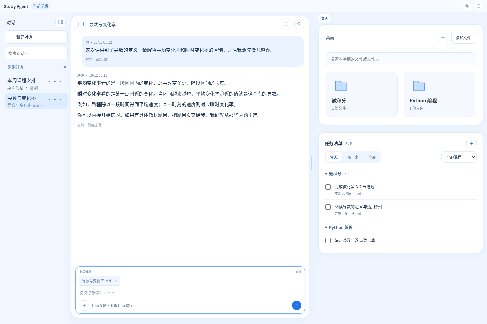

# Study Agent

Study Agent 是一个放课程文件、与 AI 学习助理交谈的学习桌面。主界面包含文件夹、任务清单和对话框；打开材料后，可以一边阅读，一边围绕文件提问。

它把课程材料、学习任务、笔记、练习和反馈连接起来，帮助你在多门课程之间持续学习，并结合实际进度与你商量下一步。你可以用它来：

- **整理课程材料**：收集课件、教材、课堂讲稿、录音转写和作业，整理到对应课程，记录来源与实际授课范围。
- **制作学习笔记**：依据真实材料编写或更新笔记，解释概念和推导，制作 PDF 并检查内容与排版。
- **安排学习任务**：维护周计划与今日清单，跟踪截止日期、剩余工作和仍需等待的材料。
- **组织练习与检测**：从教材原题、教师习题、已有练习和考试样题中选题，根据已讲范围与实际需要安排巩固练习或概念检测。
- **跟踪学习反馈**：保留独立作答、成绩、具体错点和再次练习的表现，用真实反馈调整后续学习。
- **分开管理不同学期**：各学期的课程材料、任务和学习记录保持独立，可以沿用适合跨学期使用的学习习惯。

这套流程由你与助理共同推进：助理处理材料、制作学习成果并维护记录；阅读、独立作答和正式提交由你完成。**笔记生成了不代表你已经读过，练习发出了不代表你已经做完，做对一次也不等于稳定掌握。**阅读、练习和提问没有固定先后顺序，各门课的方法根据实际材料和你的需求确定。

[下载与安装](#下载与安装) · [第一次使用](#从空桌面开始) · [准备材料](#你需要提供哪些内容) · [教材检索](#在教材中找内容) · [组织练习](#练习怎样组织) · [换学期](#换学期与保留资料)

## 下载与安装

当前提供 **0.1.8 用户测试版**。可以直接下载下面的安装包，也可以打开[版本下载页面](https://github.com/zhc070307/study-agent/releases/tag/v0.1.8)查看版本说明：

| 电脑 | 下载 | 安装方式 |
| --- | --- | --- |
| Apple 芯片 Mac，macOS 14 或更新 | [Mac 安装包](https://github.com/zhc070307/study-agent/releases/download/v0.1.8/Study-Agent-0.1.8-mac-arm64.dmg) | 打开 `.dmg`，将 Study Agent 拖到“应用程序”，再打开它。 |
| Windows 10（1903 或更新）/ 11，64 位 Intel 或 AMD 电脑 | [Windows 安装包](https://github.com/zhc070307/study-agent/releases/download/v0.1.8/Study-Agent-0.1.8-win-x64.exe) | 打开 `.exe`，按安装向导完成，然后从开始菜单或桌面打开。 |

版本下载页面中，`Source code` 是源码；安装软件请选择 `.dmg` 或 `.exe`。

目前不提供 Intel Mac 或 Windows ARM 安装包。应用已包含运行组件、PDF 阅读工具和常用中文 LaTeX 宏包，无需自行安装 Python、Node、TeX 或 Docker。普通学习功能使用在线助理，不要求电脑有独立显卡，也不下载本地大模型。

安装包包含排版组件，安装可能需要几分钟，请等安装向导完成后再打开。卸载应用会保留学习资料；重要内容仍建议先下载学期备份。

测试版还没有正式发行者签名与 Apple 公证，系统可能提示无法验证发行者。只在确认安装包来自本项目维护者后继续：Mac 可在“系统设置 → 隐私与安全性”中允许打开；Windows 若显示“更多信息 → 仍要运行”，可在核对来源后使用。无需关闭电脑的整体安全保护。

## 软件更新

带有更新入口的版本会在打开后检查新版，不会自动打断学习。发现新版时，右上角会显示提示；也可以在“设置”中点“检查更新”。下载完成后，等助理、文件处理和录音转写结束，再选择“重启更新”。课程资料、学习记录和服务密钥会保留。

`0.1.5` 起提供更新入口。使用早期测试版的用户，需要先手动安装一次当前版本。Mac 测试包尚无正式签名，暂时通过提示打开版本下载页面，下载安装新版；正式签名后才支持应用内重启安装。

新版由公开的 GitHub 版本页面提供，无需登录 GitHub，也无需另外部署服务器。检查失败或暂时没有网络时，当前版本仍可使用。

## 助理服务与资料隐私

打开后可以直接阅读文件、手动整理。需要助理时，点击“设置助理”或右上角“设置”，填写 [DeepSeek 服务密钥](https://platform.deepseek.com/api_keys)。这是让助理回答问题和处理材料所需的服务凭证，模型服务可能产生费用，由你的 DeepSeek 账户承担。密钥保存后，再次打开和更换学期都无需重新填写；它只保存在当前电脑的私有设置中，不包含在学期备份里。

资料、作答和学习记录保存在电脑上。与助理交谈时，问题和它处理所需的相关材料会发送给 DeepSeek；录音识别在本机进行，得到的文字稿在交给助理处理时也可能发送给 DeepSeek。请助理整理、回答或制作材料时需要联网；已保存文件可以直接阅读，手动整理不需要联网。

## 从空桌面开始

第一次使用不需要先建立完整的学习计划。选一门课、一份材料和一个当前想解决的问题，就可以开始。

1. **说明学期与课程。**例如：“这是我的秋季学期，我有微积分、线性代数和物理三门课。”也可以点击桌面的“＋”创建课程。
2. **把材料放到桌面。**将文件拖进桌面，或点击“添加文件”。新文件先进入待整理区域，不需要你先选课程文件夹。
3. **告诉助理这是什么、你想做什么。**例如：“这份课件属于微积分，老师今天讲到换元积分。请帮我整理，并解释第 12 页。”助理会读取实际内容，再处理你的要求。

每个学期下面是课程文件夹，每门课里面再按用途放课程资料、笔记、练习和作业。助理整理新文件后，会将它们放到相应分类；生成的笔记、练习和 PDF 也保存在对应课程内。归属不清楚时，助理会先与你确认。

文件夹可以按你的习惯增加、移动或改名。助理的内部规则与记忆不会混在这些学习文件里。后续有新材料时，仍然直接放到桌面，再请助理整理，不用在多个课程文件夹之间来回寻找上传位置。

## 文件和对话怎么用

`0.1.8` 安装包已包含以下操作。重启应用、切换模型或返回旧学期后，可以继续原来的对话。

- **找到、整理文件。**桌面的搜索框可以按文件名、课程名或所在文件夹查找当前学期的文件。同名文件会显示各自的位置；点击文件路径可以直接进入对应文件夹。选中的文件可以拖进文件夹，也可以点击“移动”。
- **边看边问。**打开文件后可以划词提问、关联其他材料或并排查看。点击对话中的文件和关联材料会打开预览，保留当前对话与正在写的问题。对话标题说明正在讨论哪份文件；需要进入另一份文件自己的对话时，可以从桌面打开它，或在对话侧栏中选择。
- **接着上次的工作。**各对话分别保留未发送的问题，PDF 支持连续滚动、跳页、缩放和划词提问，并记住阅读位置。练习中尚未完成的文字保留为草稿；点击“保存作答”或“带着作答提问”才保存为作答记录，仍不自动表示练习完成。
- **找到过去的讨论。**对话列表与聊天在同一侧，文件在另一侧预览，无需打开管理弹窗。在侧栏新建、搜索或重命名对话；不再需要的讨论可以归档，之后从“已归档”列表恢复。归档会保留消息和草稿，不会删除课程文件、任务或学习成果。对话内的搜索可以定位某次解释。消息可以复制，代码块可以单独复制。你的旧问题可以放回输入框继续编辑，助理的回复可以引用提问，都不会直接替你发送。对话可以展开占据窗口，输入框随问题长度增长。
- **出错后继续。**文件保存失败时编辑框保留修改，发送失败时保留问题；发送后新写的内容也会保留。助理工作时可以向上阅读旧消息，不会被新回复拉回底部，可以自行滚动到最新消息，界面不会用悬浮按钮遮住正文。

常用快捷键：`⌘/Ctrl K` 查找文件，`⌘/Ctrl Shift F` 查找历史对话；焦点在助理区域时，`⌘/Ctrl F` 查找当前对话。输入框按 Enter 发送，Shift Enter 换行。

## 你需要提供哪些内容

助理需要知道你实际在学什么，以及哪些资料能够作为依据。已有材料可以先交进来，缺少的内容按当前任务补充，**不要求一次准备齐整个学期的资料**。

| 内容 | 可以提供什么 | 用来做什么 |
| --- | --- | --- |
| 课程信息 | 课程名称、学习目标；已有的课程大纲、考核要求、作业说明和截止日期 | 明确课程要求，区分正式作业与额外练习，安排真实期限 |
| 教学材料与范围 | 课件、教师讲义、教材相关章节、课堂讲稿或转写稿；本次实际讲到哪里、哪些内容尚未讲 | 解释知识、整理笔记、确定练习范围，避免把整份课件当作已经讲完 |
| 教材与原题 | 教材名称和版本，相关章节与习题页，完整题面、题号、小问和配图 | 选用真实原题、核对条件与来源、编排符合课程需要的练习 |
| 教师习题与考试资料 | 作业题、习题课材料、样卷或往年题；已有的评分标准和参考解答 | 了解题型和要求，区分必须提交的题与自选训练；有依据时参考考试难度 |
| 你的实际作答 | 手写作答的清晰照片或扫描件、文字答案、解题过程、教师批改和成绩 | 找出具体问题，保留真实表现，判断后续是否需要讲解、换题或再次检测 |
| 你的安排与偏好 | 可用学习时间、近期重点、希望的题量与讲解方式、暂时不想做的事 | 与你商量安排，并根据反馈调整方法 |

**如果主要想用它组织练习，请优先提供教材原题或教师认可的题源。**可以上传整本教材，也可以只提供相关章节和习题页。使用教材原题时，需要有可读取的完整题面；书名、版本和题号帮助定位，但不能替代原题。教材已经保存后，助理应从原教材定位，不反复要求你重新上传同一题目页。题目跨页、引用图形或共用条件时，需要一起读取；照片或扫描件应能看清公式、下标与图中的标注。

参考答案、解答和评分标准有助于核对，但不必等拿到答案才能开始。可以与题目一起提供；独立作答前，助理应保留答案和解法，等批改或你要求讲解时再展示。没有可靠答案或材料不清楚时，助理应说明核对的限制，必要时请你补充。

课程方法也可以直接在对话里约定，例如：“微积分练习主要从这本教材选题”“这门课先练证明”“所有课程都用简洁的中文讲解”。只适用于某门课的要求留在那门课；通用偏好可以跨学期参考。材料能回答的问题由助理先查材料，仍影响当前任务的缺项再与你沟通。

## 在教材中找内容

教材检索采用“**保留原教材，用索引定位，再读原页**”的方式。把教材 PDF 放到桌面并交给助理整理后，就可以说：“以后这门课主要用这本教材，请帮我建立检索”“在这本书中找到弧长的推导”或“找一下第 8.1 节的相关习题”。索引由助理建立和维护，你不用运行命令或填写配置。

助理按页保存可检索文字，根据实际目录和原页核对章节，以及纸书页码与 PDF 页码的对应。查询时返回候选页、文字片段和教材版本，再读取原页；公式、图形和完整题面仍以原 PDF 为准。整本教材不需要每次从头读，未知的版本、章节或页码对应不会凭空补上。

当前采用关键词检索。英文教材的中文问题由助理结合语境换成相应英文术语再查，不是自动语义搜索。没有命中时可以换关键词、查目录或按页定位，不能据此断定书中没有内容。扫描页可能没有可提取文字，会明确提示，当前不自动进行文字识别。

教材换版本后需要重新建立对应索引；移动或改名不会让已有索引失效。索引与页码说明随学期备份保存，恢复后仍能使用。教材索引只是寻找材料的辅助，不表示那些内容已经讲过、读过或掌握。

当前的 `0.1.8` 安装包已包含教材检索、实时回复和启动时不自动弹出设置窗口的改进。使用 `0.1.0` 首轮测试版的用户，请通过本页的下载链接安装当前版本。

## 练习怎样组织

练习很大程度上依赖你提供的真实题源。助理结合实际已讲范围、教材原题、教师要求、已有练习与作答记录，选择适合当前目标的题目；不会按课程名称固定套用一种卷型，也不会默认所有课程都需要同样的题量。

你可以这样提出要求：

> 这些是微积分教材第三章的习题页和本周作业。老师讲到 3.2 节，3.3 还没讲。本周作业中的题不要重复选，另外选几道练习，控制在半小时左右，先不要给答案。

助理应逐题读取原题，核对题号、条件、小问和必要图形，保留题源，并对照你已做的题、已发出的练习和待交作业检查重复。需要重复训练时说明原因；需要改编或自拟时明确标注，不能把自拟题冒充教材原题或考试原题。你提出的时长是选题参考，实际耗时仍以你的反馈为准。

**没有合适题源时，也可以先解释概念或做明确标注的自拟练习。**助理应说明当前依据和缺少的材料，不凭书名编造原题，不在没有考试资料时声称练习已经精确达到考试难度。

自组练习可以制作成 PDF，保存到相应课程的练习分类中，保留足够作答空间；独立检测前不展示答案和解法提示。官方作业保持独立，额外练习不会替你完成、取消或提交它。想直接使用老师发的原练习，也不必另组一份新卷。

做完后，把自己的答案和过程交给助理。可以在练习页面保存文字作答，也可以上传手写照片或扫描件，并说明对应哪份练习、哪些题。例如：“这是刚才那份练习的答案，第 4 题只做到一半。请核对我的过程，再解释卡住的地方。”

助理会结合原题与实际作答记录具体问题；后续可以讲解、换题、减少题量或在合适时候再次检测，由你的要求和已约定的方法决定。看过解答、做过示例与独立完成应分别说明；没有交作答时，不会凭练习已经生成就记为掌握。

## 笔记怎样制作

把本次课件、讲义、教材相关部分和已有笔记交给助理，再说明希望覆盖的范围与用途。例如：“以老师今天讲的内容为主，更新原来的笔记，把换元积分的条件和关键步骤解释清楚，不必重写已懂的部分。”课堂转写可帮助还原讲授内容，但并非必需。

笔记应说明概念、符号、适用条件和关键推理，保留必要例题与图形，按知识关系组织，方便直接阅读。材料不完整或授课终点不明时应说明，不把补充知识冒充老师已经讲过的内容。已有笔记合适时可以更新或复用，不要求每节课都生成新文件。

制作 PDF 时，助理应核对材料内容，编译后查看实际页面，检查公式、中文、图形和跨页。无法完成某项核验时说明限制；生成成功本身不代表内容已经全部核实。独立练习按需要另存，不默认附在笔记末尾。

## 日常怎么用

课前可以放入课件、讲义和已有的问题，让助理帮助准备；课后可以补充课堂资料、文字稿和自己的想法，让助理帮你梳理。告诉它本次实际讲到的位置、老师强调的要求，或你仍不确定的范围。有现成讲稿或转写稿就直接使用，无需录音或安装转写工具。

这些都是可选方式，不要求每节课录音，也不规定阅读和练习的先后顺序。你可以直接问一道题、先做练习，或只整理文件；助理不应把每次提问都变成一套新的学习计划。

打开文件后，就可以在旁边的对话区围绕它提问。阅读 Markdown 或 PDF 时可以选中文字，再点“问助理”；也可以同时关联多个文件。练习页面支持保存作答并带着作答讨论。

任务清单按课程分组，可以查看今天、接下来的安排或全部任务，也能筛选某门课程。需要周计划时，告诉助理近期可用时间、正式截止日期和优先事项；不知道要花多久的工作可以先保留未知，再根据实际进度调整。暂时缺少材料的事项应说明在等什么，目标日期与教师规定的截止日期分别处理。

完成的事项收在“已完成”中。勾选表示你确认完成这项任务，不直接证明掌握；助理制作文件、你阅读或作答、正式提交和后续掌握情况分别记录。助理不会因为已经生成作业文件，就宣称你已向学校提交。

可以直接说：“这周时间少一点，减少额外练习”“这几道题我做得很顺，后面增加一点难度”“这门课先练习再看笔记”。助理应落实当前反馈，需要改变重要方法时与你商量；一次临时调整不会自动变成所有课程的长期规则。

## 录音转写

录音转写是可选功能。桌面应用会管理本机转写服务，无需单独打开另一个软件。打开录音，点击“转写”，先检查设备的显卡、实际可用内存和磁盘空间；设备适合且你同意时，才下载推理组件和约 3.8 GiB 模型，不会默认改用 CPU 转写。

首次安装的设备检查要求如下；这里的内存与显存指当时空闲的容量，不是电脑标称总容量：

| 加速设备 | 可用内存 | 可用显存 | 空闲磁盘 |
| --- | --- | --- | --- |
| Apple Silicon 的 Metal | 至少 8 GiB | 使用统一内存 | 至少 10 GiB |
| NVIDIA 显卡 | 至少 6 GiB | 至少 6 GiB | 至少 18 GiB |

两种设备都还需要至少 2 GiB 临时空间。NVIDIA 驱动需要支持 CUDA 12.8，Windows 检查门槛为 570.65。下载需要连接组件与模型的下载服务；网络失败不会被显示为安装成功，可以稍后重试。通过设备检查只代表资源满足门槛，识别效果与速度仍需在测试用户的真实设备和录音上确认。

已有文字稿时直接交给助理即可，无需获取转写组件。

## 换学期与保留资料

在顶部学期菜单中创建新学期。不同学期的课程、文件、任务和对话分别保存；旧学期可以归档，需要时再打开。

某门课的要求应留在那门课中。可以跨学期使用的沟通偏好和学习习惯，由助理结合你的意愿决定是否保留。记忆只是帮助理解你的参考，你当前的要求优先。

你可以说：“归档这个学期，下学期继续沿用简洁讲解的习惯，课程进度重新开始。”助理可按你的要求整理保留的内容，说明主要取舍；不会把旧任务、旧日期或旧掌握情况当作新学期进度。

移除学习内容前，助理应说明涉及的资料；要求明确时直接处理，范围不清时再沟通。当前文件与学期移除可以恢复，**不等于永久删除**；当前版本不提供永久删除入口。可以在学期菜单下载备份，或恢复备份为一个独立学期；恢复不会覆盖现有学期和通用偏好。备份中旧的学习偏好交给助理作为参考，是否继续使用由你决定。备份完成后将下载的文件保存到另一处，重要原件也请另外保留。

## 支持的材料

支持 Markdown、LaTeX、文本、PDF、常用图片和音频。文本支持 UTF-8，以及带 BOM 的 UTF-16、UTF-32；原始文件字节随备份保留。不能确认编码时会保留原件并提示另存为 UTF-8，不用替换字符掩盖读取错误。普通文件目前上限为 100 MB，录音为 200 MB。LaTeX 支持编辑和编译为 PDF；编译失败时保留上一版 PDF。使用特殊宏包、字体或外部图片的文档，还需要相应依赖和附件。

扫描件、模糊照片或缺页材料可能无法完整读取；遇到这些情况，助理应指出缺失部分并请你补充，不能把无法核实的内容当成已经确认。当前版本不提供开箱即用的外部日历同步、系统定时提醒或学校作业平台的自动提交；你可以直接提供日期与安排，在应用内维护任务。

本项目采用 [MIT 许可证](LICENSE)。所采用的第三方源码与可选转写工具保留各自许可，详见 [第三方许可说明](THIRD_PARTY_NOTICES.md)。
